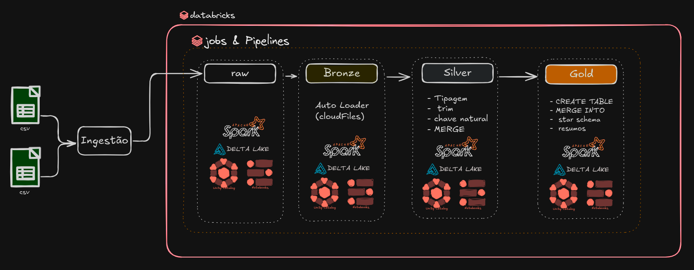
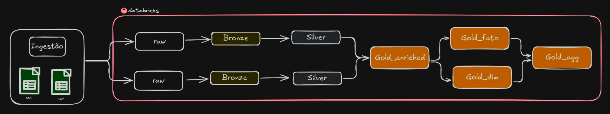
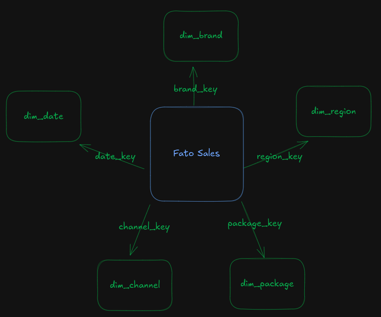

# Beverage Sales Analytics: pipeline medalhão no Databricks

MVP de uma plataforma analítica de vendas de bebidas, construído como caso técnico de Engenharia de Dados.
O projeto ingere dois arquivos CSV, trata e integra os dados em camadas (bronze, silver e gold), modela um **star schema** e responde a perguntas de negócio usando apenas o modelo dimensional.

---

## Sumário

1. [Objetivo](#1-objetivo)
2. [Stack](#2-stack)
3. [Arquitetura](#3-arquitetura)
4. [Dados de origem](#4-dados-de-origem)
5. [Estrutura do Unity Catalog](#5-estrutura-do-unity-catalog)
6. [Camadas do pipeline](#6-camadas-do-pipeline)
7. [Modelo dimensional](#7-modelo-dimensional)
8. [Orquestração (Job)](#8-orquestração-job)
9. [Consultas de negócio](#9-consultas-de-negócio)
10. [Qualidade e conferência dos dados](#10-qualidade-e-conferência-dos-dados)
11. [Decisões de projeto](#11-decisões-de-projeto)
12. [Como executar](#12-como-executar)
13. [Estrutura do repositório](#13-estrutura-do-repositório)
14. [Limitações e próximos passos](#14-limitações-e-próximos-passos)

---

## 1. Objetivo

Construir um MVP que:

1. Una as características de canal ao histórico transacional de vendas.
2. Implemente a ingestão com **modelagem dimensional** (mínimo de 2 dimensões, 1 fato e tabelas de resumo), com 100% dos dados ingeridos.
3. Responda às perguntas de negócio **sobre o modelo criado**, e não sobre os arquivos de origem:
   * Top 3 trade groups por região em volume de vendas.
   * Volume de vendas de cada marca por mês.
   * Marca com menor volume de vendas em cada região.
4. Liste evoluções e funcionalidades futuras após o MVP.

---

## 2. Stack

| Item | Escolha |
|---|---|
| Plataforma | Databricks Free Edition (compute serverless) |
| Governança e armazenamento | Unity Catalog, com Volumes para arquivos, checkpoints e metadados do Auto Loader |
| Formato das tabelas | Delta Lake |
| Linguagens | PySpark (bronze e silver) e Spark SQL via `spark.sql` (gold) |
| Ingestão bronze | Auto Loader (`cloudFiles`) com `trigger(availableNow=True)` |
| Upsert | `MERGE` (Delta) na silver e na gold |
| Orquestração | Databricks Jobs (DAG de 8 tasks, definição em `job/job.json`) |
| Interface | Notebooks (`.ipynb`) |

---

## 3. Arquitetura

### Visão geral



Os CSVs entram por uma etapa de ingestão (upload para um Volume do Unity Catalog) e atravessam as camadas **raw, bronze, silver e gold**. Cada camada tem uma responsabilidade:

| Camada | Responsabilidade |
|---|---|
| Raw | Arquivos CSV originais, sem alteração, em um Volume |
| Bronze | Ingestão incremental com Auto Loader: schema inferido, `_rescued_data` e metadados de origem |
| Silver | Tipagem defensiva, limpeza, chave natural e `MERGE` (upsert idempotente) |
| Gold | `CREATE TABLE` + `MERGE INTO`, star schema e tabelas de resumo |

### Fluxo de execução



Cada CSV segue uma trilha própria até a silver. As duas trilhas se encontram na gold (`Gold_enriched`), onde acontece o join. A partir daí, dimensões e fato são carregadas **em paralelo** e os resumos dependem dos dois ramos.

---

## 4. Dados de origem

| Arquivo | Conteúdo | Formato |
|---|---|---|
| `abi_bus_case1_beverage_sales_*.csv` | Vendas semanais por marca, região, canal e embalagem | UTF-16 LE com BOM, separador TAB, fim de linha CRLF |
| `abi_bus_case1_beverage_channel_group_*.csv` | Características de cada canal de venda | UTF-8 com BOM, separador vírgula |

### Vendas (13 colunas, 16.151 linhas)

| Coluna original | Descrição |
|---|---|
| `DATE` | Data da semana (formato `M/d/yyyy`) |
| `CE_BRAND_FLVR` | Código da marca/sabor |
| `BRAND_NM` | Nome da marca |
| `Btlr_Org_LVL_C_Desc` | Região |
| `CHNL_GROUP` | Grupo de canal (15 valores) |
| `TRADE_CHNL_DESC` | Canal (31 valores). **Chave de junção** com o arquivo de canal |
| `PKG_CAT`, `Pkg_Cat_Desc` | Categoria de embalagem e descrição |
| `TSR_PCKG_NM` | Nome do pacote (8 valores) |
| `$ Volume` | Volume de vendas em $ (a medida) |
| `YEAR`, `MONTH` | Ano e mês |
| `PERIOD` | **Semana do mês (1 a 5)**, não o mês |

O período coberto vai de **janeiro a março de 2006**, com 13 datas distintas, 7 regiões e 4 marcas.

### Canal (3 colunas, 31 linhas)

`TRADE_CHNL_DESC` (chave), `TRADE_GROUP_DESC` (6 grupos) e `TRADE_TYPE_DESC` (3 tipos).
Os 31 canais das vendas existem todos no arquivo de canal, então o join não perde nem multiplica linhas.

---

## 5. Estrutura do Unity Catalog

Todo o projeto vive em um único catálogo, `martech_dev`, com um schema por camada. O catálogo é informado às tasks pelo parâmetro `CATALOG`.


```
martech_dev                          (catálogo)
├── raw
│   └── Volumes: raw_files           CSVs de origem
├── bronze
│   ├── Tables:  tb_sales, tb_channel_group
│   └── Volumes: autoloader_metadata, checkpoint
├── silver
│   ├── Tables:  tb_sales, tb_channel_group
│   └── Volumes: checkpoint
├── gold
│   └── Tables:  tb_sales_enriched,
│                dim_date, dim_brand, dim_region, dim_channel, dim_package,
│                fact_sales,
│                agg_sales_region_trade_group, agg_sales_brand_month, agg_sales_region_brand
├── default                          (criado automaticamente)
└── information_schema               (criado automaticamente)
```

### Para que serve cada Volume

| Volume | Caminho usado pelo Job | Conteúdo |
|---|---|---|
| `raw.raw_files` | `/Volumes/martech_dev/raw/raw_files/beverage/sales/` e `.../beverage/channel_group/` | CSVs de origem, uma pasta por fonte |
| `bronze.checkpoint` | `/Volumes/martech_dev/bronze/checkpoint/sales` e `.../channel_group` | Checkpoint do stream do Auto Loader (arquivos já processados) |
| `bronze.autoloader_metadata` | `/Volumes/martech_dev/bronze/autoloader_metadata/sales/schema` e `.../channel_raw/schema` | Schema inferido e evoluído pelo Auto Loader |
| `silver.checkpoint` | `/Volumes/martech_dev/silver/checkpoint/sales` e `.../channel_group` | Checkpoint do `readStream` da bronze para a silver |

---

## 6. Camadas do pipeline

### 6.1 Raw (Volume)

Os arquivos ficam no Volume `raw.raw_files`, em pastas separadas por fonte (`beverage/sales/` e `beverage/channel_group/`). A raw não é uma tabela Delta: guarda os arquivos exatamente como chegaram.

### 6.2 Bronze: Auto Loader

Um único notebook parametrizado (`src/bronze`, parâmetro `TABLE_NAME`) ingere as duas fontes.

* **Incremental:** `cloudFiles` com `trigger(availableNow=True)` e checkpoint. Cada arquivo é lido uma única vez.
* **Schema inferido e evolutivo:** `cloudFiles.inferColumnTypes=true` e `schemaEvolutionMode=addNewColumns`, com o schema guardado no Volume `autoloader_metadata`.
* **Dados fora do schema:** `rescuedDataColumn=_rescued_data` captura valores que não casam com o tipo inferido, em vez de descartá-los.
* **Metadados de rastreabilidade:** `_source_file` (a partir de `_metadata.file_path`) e `_ingestion_timestamp`.
* **Escrita:** tabela Delta em modo `append`, com `mergeSchema` ligado.
* **Leitura do arquivo de vendas** (`TABLE_NAME = tb_sales`): `encoding=UTF-16LE`, `sep=\t` e `lineSep=\r\n`.
* **Nomes de coluna:** na tabela de vendas, `clean_name` converte para snake_case em minúsculas, sem BOM nem símbolos (`$ Volume` vira `sales_volume`). A tabela de canal mantém os nomes do cabeçalho, e a silver os converte para minúsculas.

> **Armadilha com o arquivo de vendas:** sem o `lineSep`, o Spark divide as linhas byte a byte e deixa um caractere inválido (`�`) no fim de cada registro, o que contamina a coluna `PERIOD`. Usar `encoding=UTF-16` (sem `LE`) junto com `lineSep` lê **zero linhas**, sem dar erro. A combinação correta é `UTF-16LE` + `lineSep=\r\n`.

### 6.3 Silver: tipagem, limpeza e MERGE

Em ambas as tabelas, a leitura da bronze é um `readStream` com `foreachBatch`. Na primeira execução a tabela é criada com `saveAsTable`, e nas seguintes o lote entra por `MERGE` (`whenMatchedUpdateAll` e `whenNotMatchedInsertAll`).

**Vendas (`silver.tb_sales`)**

* `date` vira `sale_date` (tipo `DATE`). A bronze já infere a coluna como data, então a silver converte para texto e faz o parse `yyyy-MM-dd` com `try_to_timestamp`.
* `sales_volume` vira `DECIMAL(18,2)`, e `ce_brand_flvr`, `year`, `month` e `period` viram inteiros, tudo com `try_cast`. Dado inválido vira `NULL`, e o job não quebra.
* `trim` nos campos de texto (`brand_nm` vem com espaço à esquerda em todas as linhas).
* **Chave natural** `sales_key` = SHA-256 de (data, código da marca, região, canal, categoria de pacote e nome do pacote). A combinação é única no arquivo (0 duplicidades).
* Deduplicação dentro do lote por `sales_key`, mantendo o `_ingestion_timestamp` mais recente, porque o `MERGE` exige uma linha de origem por chave.
* Reprocessar não duplica, e um valor corrigido na origem atualiza a linha existente.

**Canal (`silver.tb_channel_group`)**

* `trim` nas três colunas e uma linha por `trade_chnl_desc` (a mais recente por `_ingestion_timestamp` e `_source_file`).
* `MERGE` pela mesma chave, com comparação segura para nulos (`<=>`).

### 6.4 Gold: join, dimensões, fato e resumos

Implementada em Spark SQL: `CREATE TABLE IF NOT EXISTS` com schema explícito e `MERGE INTO`.

| Task | Notebook | Produz | Observação |
|---|---|---|---|
| `Gold_enriched` | `gold_enriched` | `tb_sales_enriched` | `LEFT JOIN` entre silver de vendas e de canal por `trade_chnl_desc`. Venda sem canal não some. `MERGE` por `sales_key` |
| `Gold_dim` | `gold_dim` | `dim_date`, `dim_brand`, `dim_region`, `dim_channel`, `dim_package` | Função `merge()` aplica `MERGE INTO` pela chave substituta, com a fonte deduplicada por `ROW_NUMBER` |
| `Gold_fato` | `gold_fato` | `fact_sales` | `MERGE` por `sales_key`, com as chaves substitutas calculadas na própria carga |
| `Gold_agg` | `gold_agg` | `agg_sales_region_trade_group`, `agg_sales_brand_month`, `agg_sales_region_brand` | `CREATE OR REPLACE TABLE ... AS SELECT` sobre a fato e as dimensões |

---

## 7. Modelo dimensional



**Grão da fato:** uma linha por venda (data x marca x região x canal x pacote). A medida é `sales_volume`. Volumes negativos representam devoluções ou ajustes e foram mantidos, para que a soma bata com a origem.

| Tabela | Chave | Atributos |
|---|---|---|
| `fact_sales` | `sales_key` (PK) | `date_key`, `brand_key`, `region_key`, `channel_key`, `package_key`, `sales_volume`, `_gold_updated_at` |
| `dim_date` | `date_key` (yyyyMMdd) | `sale_date`, `year`, `quarter`, `month`, `month_name`, `year_month`, `week_of_month` |
| `dim_brand` | `brand_key` | `ce_brand_flvr`, `brand_nm` |
| `dim_region` | `region_key` | `region_name` |
| `dim_channel` | `channel_key` | `trade_chnl_desc`, `chnl_group`, `trade_group_desc`, `trade_type_desc` |
| `dim_package` | `package_key` | `tsr_pckg_nm`, `pkg_cat`, `pkg_cat_desc` |

**Chaves substitutas:** `xxhash64(COALESCE(CAST(chave_natural AS STRING), 'UNKNOWN'))`. São determinísticas, então a fato e a dimensão calculam a mesma chave de forma independente, sem join entre elas na carga. É isso que permite carregar `Gold_dim` e `Gold_fato` em paralelo. A exceção é `dim_date`, cuja chave é a própria data no formato `yyyyMMdd`.

**Pontos do modelo**

* `dim_channel` reúne duas hierarquias diferentes: `chnl_group` (15 grupos, vem das vendas) e `trade_group_desc` (6 grupos, vem do arquivo de canal). A pergunta de trade group usa a segunda.
* `period` é a semana do mês e fica em `dim_date` como `week_of_month`. Para "por mês", use `year_month`.
* Atributo nulo vira `'UNKNOWN'` nas dimensões, então nenhuma venda perde a ligação com a dimensão.

---

## 8. Orquestração (Job)


O Job `job_beverage` (definição em [`job/job.json`](job/job.json)) tem 8 tasks de notebook em compute serverless. Está configurado com `max_concurrent_runs = 1`, fila habilitada e `performance_target = PERFORMANCE_OPTIMIZED`.

| Task | Notebook | Depende de | Parâmetros principais |
|---|---|---|---|
| `rawToBronze_Sales` | `bronze` | | `TABLE_NAME=tb_sales`, `RAW_PATH`, `CHECKPOINT_PATH`, `SCHEMA_PATH`, `CATALOG`, `SCHEMA=bronze` |
| `rawToBronze_channel_group` | `bronze` | | `TABLE_NAME=tb_channel_group` e os mesmos parâmetros, com os caminhos do canal |
| `BronzeToSilver_Sales` | `silver_sales` | `rawToBronze_Sales` | `CATALOG`, `CHECKPOINT_PATH` |
| `BronzeToSilver_Channel_group` | `silver_channel_group` | `rawToBronze_channel_group` | `CATALOG`, `CHECKPOINT_PATH` |
| `Gold_enriched` | `gold_enriched` | as duas silvers | `CATALOG` |
| `Gold_dim` | `gold_dim` | `Gold_enriched` | `CATALOG` |
| `Gold_fato` | `gold_fato` | `Gold_enriched` | `CATALOG` |
| `Gold_agg` | `gold_agg` | `Gold_dim` e `Gold_fato` | `CATALOG` |

`Gold_dim` e `Gold_fato` executam em paralelo, e `Gold_agg` só começa depois dos dois.

---

## 9. Consultas de negócio

As consultas leem **somente** o modelo gold: as tabelas `agg_*`, que são construídas a partir da fato e das dimensões. Rode-as no SQL Editor ou em um notebook, com o catálogo `martech_dev` selecionado (`USE CATALOG martech_dev`).

### 4.1 Top 3 trade groups por região

```sql
SELECT region_name, trade_group_desc, total_sales_volume, ranking
FROM (
    SELECT region_name, trade_group_desc, total_sales_volume,
           ROW_NUMBER() OVER (PARTITION BY region_name
                              ORDER BY total_sales_volume DESC, trade_group_desc) AS ranking
    FROM gold.agg_sales_region_trade_group
)
WHERE ranking <= 3
ORDER BY region_name, ranking;
```

Resultado esperado (arquivos de 2021-07-26): em todas as 7 regiões o top 3 é `GROCERY`, `SERVICES` e `ACADEMIC`, nessa ordem.

| Região | GROCERY | SERVICES | ACADEMIC |
|---|---:|---:|---:|
| CANADA | 168.640,07 | 83.748,07 | 53.117,56 |
| GREAT LAKES | 380.297,19 | 157.798,64 | 152.043,01 |
| MIDWEST | 326.351,39 | 129.258,60 | 88.605,37 |
| NORTHEAST | 403.710,65 | 156.009,97 | 149.577,11 |
| SOUTHEAST | 416.665,90 | 225.921,87 | 126.043,62 |
| SOUTHWEST | 271.246,68 | 156.455,22 | 76.773,69 |
| WEST | 206.064,04 | 87.972,77 | 79.397,42 |

### 4.2 Vendas por marca e por mês

```sql
SELECT year_month, brand_nm, total_sales_volume
FROM gold.agg_sales_brand_month
ORDER BY year_month, brand_nm;
```

| Mês | GRAPE | LEMON | RASPBERRY | STRAWBERRY |
|---|---:|---:|---:|---:|
| 2006-01 | | 505.845,22 | 392.551,70 | 315.902,65 |
| 2006-02 | | 550.940,85 | 409.661,52 | 345.518,40 |
| 2006-03 | 7,50 | 765.942,58 | 587.522,56 | 475.032,18 |

### 4.3 Marca com menor venda por região

```sql
SELECT region_name, brand_nm, total_sales_volume
FROM (
    SELECT region_name, brand_nm, total_sales_volume,
           DENSE_RANK() OVER (PARTITION BY region_name ORDER BY total_sales_volume ASC) AS rnk
    FROM gold.agg_sales_region_brand
)
WHERE rnk = 1
ORDER BY region_name;
```

| Região | Marca | Volume |
|---|---|---:|
| CANADA | STRAWBERRY | 74.009,61 |
| GREAT LAKES | STRAWBERRY | 208.747,90 |
| MIDWEST | STRAWBERRY | 149.206,78 |
| NORTHEAST | STRAWBERRY | 195.581,49 |
| SOUTHEAST | RASPBERRY | 223.958,50 |
| SOUTHWEST | GRAPE | 7,50 |
| WEST | STRAWBERRY | 134.511,18 |


---

## 11. Decisões de projeto

| Decisão | Motivo |
|---|---|
| Um notebook de bronze parametrizado para as duas fontes | Reuso: só mudam o `TABLE_NAME` e os caminhos. As particularidades da fonte de vendas (encoding, separador, `lineSep`) ficam isoladas em um `if` |
| Auto Loader com `availableNow` | Processa só os arquivos novos e encerra, o que combina com Job agendado e com compute serverless |
| `_rescued_data` na bronze | O que não casa com o schema é preservado para auditoria, e nada é descartado em silêncio |
| `try_cast` e `try_to_timestamp` na silver | Dado ruim vira `NULL` em vez de derrubar o job |
| Chave natural por hash na silver | O CSV não tem ID. O `MERGE` precisa de uma chave estável para ser um upsert de verdade |
| Join feito na gold (`Gold_enriched`) | A silver mantém uma tabela por fonte, e a gold integra |
| `LEFT JOIN` e `COALESCE` para `UNKNOWN` | Venda sem canal não some, e o total continua batendo com a origem |
| Chaves substitutas por `xxhash64` | Determinísticas: permitem cargas paralelas e reprocessamento sem sequências |
| Volumes negativos mantidos | A soma reconcilia com a origem, e a devolução continua identificável |
| Resumos recriados a cada execução | Com este volume, é mais simples e seguro que atualizar incrementalmente |
| Gold em Spark SQL | Schema explícito e `MERGE INTO` legíveis, próximos do que um analista revisaria |

---

## 12. Como executar

### Pré-requisitos

* Workspace Databricks (Free Edition funciona) com Unity Catalog.
* O catálogo `martech_dev`, com os schemas `raw`, `bronze`, `silver` e `gold` e os Volumes descritos na [seção 5](#5-estrutura-do-unity-catalog). O notebook `src/utils` contém os comandos `CREATE ... IF NOT EXISTS` de setup.

### Passo a passo

1. **Estrutura:** crie o catálogo, os schemas e os Volumes (seção 5).
2. **Upload:** envie cada CSV para a pasta própria no Volume `raw.raw_files`:
   * vendas em `/Volumes/martech_dev/raw/raw_files/beverage/sales/`
   * canal em `/Volumes/martech_dev/raw/raw_files/beverage/channel_group/`
3. **Job:** importe os notebooks de `src/` para o workspace e crie o Job a partir de [`job/job.json`](job/job.json). Ajuste os `notebook_path` para o caminho dos notebooks no seu workspace.
4. **Execução:** rode o Job. Executar de novo é seguro: a bronze só lê arquivos novos e a silver e a gold usam `MERGE`.

### Reprocessar do zero

O Auto Loader guarda no checkpoint quais arquivos já leu. Para recarregar a mesma tabela do zero, apague também o checkpoint e o schema do Volume (`bronze/checkpoint/<fonte>` e `bronze/autoloader_metadata/<fonte>/schema`), além da tabela. Sem isso, a tabela recriada fica **vazia**, porque o Auto Loader considera o arquivo já processado. O mesmo vale para o checkpoint da silver (`silver/checkpoint/<fonte>`).

### Parâmetros dos notebooks

| Notebook | Widgets |
|---|---|
| `bronze` | `ENVIRONMENT`, `RAW_PATH`, `CHECKPOINT_PATH`, `SCHEMA_PATH`, `CATALOG`, `SCHEMA`, `TABLE_NAME` |
| `silver_sales`, `silver_channel_group` | `CATALOG`, `CHECKPOINT_PATH` |
| `gold_enriched`, `gold_dim`, `gold_fato`, `gold_agg` | `CATALOG` |

---

## 13. Estrutura do repositório

```
.
├── README.md
├── images/
│   ├── architecture_overview.png
│   ├── architecture_dag.png
│   ├── star_schema.png
│   ├── databricks_job.png
│   └── unity_catalog.png
├── job/
│   └── job.json                    # definição do Job job_beverage (8 tasks)
└── src/
    ├── utils.ipynb                 # setup: catálogo, schemas e Volumes
    ├── bronze.ipynb                # Auto Loader (vendas e canal, parametrizado)
    ├── silver_sales.ipynb          # tipagem, chave natural e MERGE
    ├── silver_channel_group.ipynb  # trim, dedupe por canal e MERGE
    ├── gold_enriched.ipynb         # join vendas + canal
    ├── gold_dim.ipynb              # 5 dimensões
    ├── gold_fato.ipynb             # fact_sales
    └── gold_agg.ipynb              # 3 tabelas de resumo
```

---

## 14. Limitações e próximos passos

**Limitações do MVP**

* A gold reconstrói enriched, fato e resumos a partir de toda a silver. Com 16 mil linhas isso é irrelevante, mas não escala para grandes volumes.
* A silver de vendas depende do tipo inferido na bronze: ela espera a coluna `date` como `DATE` (lida como `yyyy-MM-dd`). Se a inferência mudar, as datas viram `NULL`.
* Se uma venda chegar com data nula, `date_key` fica nulo e ela não casa com `dim_date`.
* A pergunta 4.3 ignora marcas sem venda na região (ver a premissa na seção 9).

**Próximos passos**

1. **Agendamento e disparo por chegada de arquivo** no Job, com alertas de falha.
2. **Reconciliação e data quality automatizadas** (DQM e DQX), com quarentena para linhas inválidas.
3. **Gold incremental:** recalcular fato e resumos só para os períodos afetados.
4. **SCD tipo 2** em `dim_channel` e `dim_brand`, para manter o histórico de mudanças.
5. **Performance em volume:** Liquid Clustering ou particionamento por data, `OPTIMIZE` e `VACUUM`.
6. **Governança:** permissões por camada no Unity Catalog, linhagem, tags e dicionário de dados.
7. **CI/CD e testes:** Databricks Asset Bundles e testes unitários das transformações (pytest).
8. **Consumo:** dashboards em Databricks SQL ou Power BI, com mais KPIs (crescimento anual, participação por marca e mix de canais).
9. **Observabilidade:** métricas de volume, atraso e custo por job, e reprocessamento controlado (backfill).
10. **Evolução analítica:** previsão de demanda e dados em near real-time.