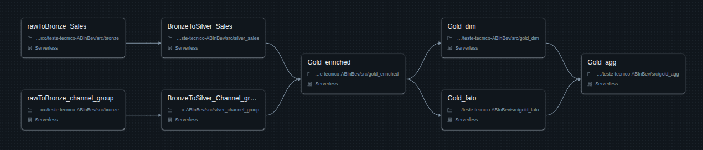

# Beverage Sales Analytics: pipeline medalhão no Databricks

MVP de uma plataforma analítica de vendas de bebidas, construído como caso técnico de Engenharia de Dados.
O projeto ingere dois arquivos CSV, trata e integra os dados em camadas (bronze, silver e gold), modela um **star schema** e responde a perguntas de negócio usando apenas o modelo dimensional.

> **Aviso:** o enunciado do caso e os arquivos de dados são de uso restrito a processos seletivos. Este repositório contém somente a solução (código e documentação). Os CSVs e o enunciado **não** devem ser versionados nem compartilhados publicamente.

---

## Sumário

1. [Objetivo](#1-objetivo)
2. [Stack](#2-stack)
3. [Arquitetura](#3-arquitetura)
4. [Dados de origem](#4-dados-de-origem)
5. [Camadas do pipeline](#5-camadas-do-pipeline)
6. [Modelo dimensional](#6-modelo-dimensional)
7. [Orquestração (Job)](#7-orquestração-job)
8. [Consultas de negócio](#8-consultas-de-negócio)
9. [Validação e qualidade dos dados](#9-validação-e-qualidade-dos-dados)
10. [Decisões de projeto](#10-decisões-de-projeto)
11. [Como executar](#11-como-executar)
12. [Estrutura do repositório](#12-estrutura-do-repositório)
13. [Limitações e próximos passos](#13-limitações-e-próximos-passos)

---

## 1. Objetivo

Construir um MVP que:

1. Una as características de canal ao histórico transacional de vendas.
2. Implemente a ingestão com **modelagem dimensional** (mínimo de 2 dimensões, 1 fato e tabelas de resumo), com 100% dos dados ingeridos.
3. Responda às perguntas de negócio **sobre o modelo criado**, e não sobre os arquivos de origem:
   * Top 3 trade groups por região em volume de vendas.
   * Volume de vendas de cada marca por mês.
   * Marca com menor volume de vendas em cada região.
4. Liste evoluções e funcionalidades futuras após o MVP.

---

## 2. Stack

| Item | Escolha |
|---|---|
| Plataforma | Databricks Free Edition (compute serverless) |
| Governança e armazenamento | Unity Catalog, com Volumes para os arquivos |
| Formato das tabelas | Delta Lake |
| Linguagens | PySpark e Spark SQL (`spark.sql`) |
| Ingestão bronze | Auto Loader (`cloudFiles`) com `availableNow` |
| Upsert | `MERGE` (Delta) na silver e na gold |
| Orquestração | Databricks Jobs (DAG de tasks) |
| Interface | Notebooks |

---

## 3. Arquitetura

### Visão geral


Os CSVs entram por uma etapa de ingestão (upload para um Volume do Unity Catalog) e atravessam as camadas **raw, bronze, silver e gold**. Cada camada tem uma responsabilidade:

| Camada | Responsabilidade |
|---|---|
| Raw | Arquivos CSV originais, sem alteração |
| Bronze | Ingestão incremental com Auto Loader: tudo como `string`, mais metadados de origem |
| Silver | Tipagem, limpeza, chave natural e `MERGE` (upsert idempotente) |
| Gold | `CREATE TABLE` + `MERGE INTO`, star schema e tabelas de resumo |

### Fluxo de execução


Cada CSV segue uma trilha própria até a silver. As duas trilhas se encontram na gold (`Gold_enriched`), onde acontece o join. A partir daí, dimensões e fato são carregadas **em paralelo** e os resumos dependem dos dois ramos.

---

## 4. Dados de origem

| Arquivo | Conteúdo | Formato |
|---|---|---|
| `abi_bus_case1_beverage_sales_*.csv` | Vendas semanais por marca, região, canal e embalagem | UTF-16 LE com BOM, separador TAB, fim de linha CRLF |
| `abi_bus_case1_beverage_channel_group_*.csv` | Características de cada canal de venda | UTF-8 com BOM, separador vírgula |

### Vendas (13 colunas, 16.151 linhas)

| Coluna original | Descrição |
|---|---|
| `DATE` | Data da semana (formato `M/d/yyyy`) |
| `CE_BRAND_FLVR` | Código da marca/sabor |
| `BRAND_NM` | Nome da marca |
| `Btlr_Org_LVL_C_Desc` | Região |
| `CHNL_GROUP` | Grupo de canal (15 valores) |
| `TRADE_CHNL_DESC` | Canal (31 valores). **Chave de junção** com o arquivo de canal |
| `PKG_CAT`, `Pkg_Cat_Desc` | Categoria de embalagem e descrição |
| `TSR_PCKG_NM` | Nome do pacote (8 valores) |
| `$ Volume` | Volume de vendas em $ (a medida) |
| `YEAR`, `MONTH` | Ano e mês |
| `PERIOD` | **Semana do mês (1 a 5)**, não o mês |

O período coberto vai de **janeiro a março de 2006**, com 13 datas distintas, 7 regiões e 4 marcas.

### Canal (3 colunas, 31 linhas)

`TRADE_CHNL_DESC` (chave), `TRADE_GROUP_DESC` (6 grupos) e `TRADE_TYPE_DESC` (3 tipos).
Os 31 canais das vendas existem todos no arquivo de canal, então o join não perde nem multiplica linhas.

---

## 5. Camadas do pipeline

### 5.1 Raw (Volume)

Os arquivos ficam em um Volume do Unity Catalog, em pastas separadas por fonte. A raw não é uma tabela Delta: guarda os arquivos exatamente como chegaram.

### 5.2 Bronze: Auto Loader

Um único notebook parametrizado (`TABLE_NAME`) ingere as duas fontes.

* **Incremental:** `cloudFiles` com `trigger(availableNow=True)` e checkpoint. Cada arquivo é lido uma única vez.
* **Tudo como string:** `inferColumnTypes=false`. A bronze nunca rejeita um dado por erro de tipo, e a tipagem é responsabilidade da silver.
* **Nomes normalizados:** snake_case em minúsculas, sem BOM nem símbolos (`$ Volume` vira `sales_volume`).
* **Metadados de rastreabilidade:** `_source_file`, `_ingestion_timestamp` e `_rescued_data`.
* **Leitura do arquivo de vendas:** `encoding=UTF-16LE`, `sep=\t` e `lineSep=\r\n`.

> **Armadilha encontrada:** sem o `lineSep`, o Spark divide as linhas byte a byte e deixa um caractere inválido (`�`) no fim de cada registro, o que contamina a coluna `PERIOD`. Usar `encoding=UTF-16` (sem `LE`) junto com `lineSep` lê **zero linhas**, sem dar erro. A combinação correta é `UTF-16LE` + `lineSep=\r\n`.

### 5.3 Silver: tipagem, limpeza e MERGE

**Vendas (`silver.tb_sales`)**

* `date` convertida para `DATE` (aceita `M/d/yyyy` e `yyyy-MM-dd`) com `try_to_timestamp`.
* Volume convertido para `DECIMAL(18,2)` com `try_cast`. Dado inválido vira `NULL`, e o job não quebra.
* `trim` em todos os textos (`brand_nm` vem com espaço à esquerda em todas as linhas).
* **Chave natural** `sales_key` = SHA-256 de (data, código da marca, região, canal, categoria e pacote). A combinação é única no arquivo (0 duplicidades).
* Leitura incremental da bronze com `foreachBatch` e `MERGE` por `sales_key`. Reprocessar não duplica, e um valor corrigido na origem atualiza a linha existente.
* Deduplicação dentro do micro-lote (fica a linha mais recente), porque o `MERGE` exige uma linha de origem por chave.

**Canal (`silver.tb_channel_group`)**

* `trim` nas colunas e uma linha por `trade_chnl_desc` (a mais recente).
* `MERGE` pela mesma chave.

### 5.4 Gold: join, dimensões, fato e resumos

Implementada em Spark SQL (`CREATE TABLE` com schema explícito e `MERGE INTO`).

| Task | Produz | Observação |
|---|---|---|
| `Gold_enriched` | `gold.tb_sales_enriched` | `LEFT JOIN` entre silver de vendas e de canal. Venda sem canal não some |
| `Gold_dim` | `dim_date`, `dim_brand`, `dim_region`, `dim_channel`, `dim_package` | `MERGE` por chave substituta, fonte deduplicada com `ROW_NUMBER` |
| `Gold_fato` | `fact_sales` | `MERGE` por `sales_key` |
| `Gold_agg` | `agg_sales_region_trade_group`, `agg_sales_brand_month`, `agg_sales_region_brand` | `CREATE OR REPLACE TABLE ... AS SELECT` sobre fato e dimensões, mais reconciliação |

---

## 6. Modelo dimensional


**Grão da fato:** uma linha por venda (data x marca x região x canal x pacote). A medida é `sales_volume`. Volumes negativos representam devoluções ou ajustes e foram mantidos, para que a soma bata com a origem.

| Tabela | Chave | Atributos |
|---|---|---|
| `fact_sales` | `sales_key` (PK) | `date_key`, `brand_key`, `region_key`, `channel_key`, `package_key`, `sales_volume` |
| `dim_date` | `date_key` (yyyyMMdd) | `sale_date`, `year`, `quarter`, `month`, `month_name`, `year_month`, `week_of_month` |
| `dim_brand` | `brand_key` | `ce_brand_flvr`, `brand_nm` |
| `dim_region` | `region_key` | `region_name` |
| `dim_channel` | `channel_key` | `trade_chnl_desc`, `chnl_group`, `trade_group_desc`, `trade_type_desc` |
| `dim_package` | `package_key` | `tsr_pckg_nm`, `pkg_cat`, `pkg_cat_desc` |

**Chaves substitutas:** `xxhash64(COALESCE(CAST(chave_natural AS STRING), 'UNKNOWN'))`. São determinísticas, então a fato e a dimensão calculam a mesma chave de forma independente, sem join entre elas na carga. É isso que permite carregar `Gold_dim` e `Gold_fato` em paralelo.

**Pontos do modelo**

* `dim_channel` reúne duas hierarquias diferentes: `chnl_group` (15 grupos, vem das vendas) e `trade_group_desc` (6 grupos, vem do arquivo de canal). A pergunta de trade group usa a segunda.
* `period` é a semana do mês e fica em `dim_date` como `week_of_month`. Para "por mês", use `year_month`.
* Atributo ausente vira `UNKNOWN`, então nenhuma venda fica sem dimensão.

---

## 7. Orquestração (Job)



| Task | Notebook | Depende de |
|---|---|---|
| `rawToBronze_Sales` | `src/bronze` (`TABLE_NAME=tb_sales`) | |
| `rawToBronze_channel_group` | `src/bronze` (canal) | |
| `BronzeToSilver_Sales` | `src/silver_sales` | `rawToBronze_Sales` |
| `BronzeToSilver_Channel_group` | `src/silver_channel_group` | `rawToBronze_channel_group` |
| `Gold_enriched` | `src/gold_enriched` | as duas silvers |
| `Gold_dim` | `src/gold_dim` | `Gold_enriched` |
| `Gold_fato` | `src/gold_fato` | `Gold_enriched` |
| `Gold_agg` | `src/gold_agg` | `Gold_dim` e `Gold_fato` |

Todas as tasks rodam em compute serverless. `Gold_dim` e `Gold_fato` executam em paralelo, e `Gold_agg` só começa depois dos dois.

---

## 8. Consultas de negócio

As consultas leem **somente** o modelo gold (tabelas `agg_*`, que vêm da fato e das dimensões).

### 4.1 Top 3 trade groups por região

```sql
SELECT region_name, trade_group_desc, total_sales_volume, ranking
FROM (
    SELECT region_name, trade_group_desc, total_sales_volume,
           ROW_NUMBER() OVER (PARTITION BY region_name
                              ORDER BY total_sales_volume DESC, trade_group_desc) AS ranking
    FROM gold.agg_sales_region_trade_group
)
WHERE ranking <= 3
ORDER BY region_name, ranking;
```

Resultado esperado (arquivo de 2021-07-26): em todas as 7 regiões o top 3 é `GROCERY`, `SERVICES` e `ACADEMIC`, nessa ordem.

| Região | GROCERY | SERVICES | ACADEMIC |
|---|---:|---:|---:|
| CANADA | 168.640,07 | 83.748,07 | 53.117,56 |
| GREAT LAKES | 380.297,19 | 157.798,64 | 152.043,01 |
| MIDWEST | 326.351,39 | 129.258,60 | 88.605,37 |
| NORTHEAST | 403.710,65 | 156.009,97 | 149.577,11 |
| SOUTHEAST | 416.665,90 | 225.921,87 | 126.043,62 |
| SOUTHWEST | 271.246,68 | 156.455,22 | 76.773,69 |
| WEST | 206.064,04 | 87.972,77 | 79.397,42 |

### 4.2 Vendas por marca e por mês

```sql
SELECT year_month, brand_nm, total_sales_volume
FROM gold.agg_sales_brand_month
ORDER BY year_month, brand_nm;
```

| Mês | GRAPE | LEMON | RASPBERRY | STRAWBERRY |
|---|---:|---:|---:|---:|
| 2006-01 | | 505.845,22 | 392.551,70 | 315.902,65 |
| 2006-02 | | 550.940,85 | 409.661,52 | 345.518,40 |
| 2006-03 | 7,50 | 765.942,58 | 587.522,56 | 475.032,18 |

### 4.3 Marca com menor venda por região

```sql
SELECT region_name, brand_nm, total_sales_volume
FROM (
    SELECT region_name, brand_nm, total_sales_volume,
           DENSE_RANK() OVER (PARTITION BY region_name ORDER BY total_sales_volume ASC) AS rnk
    FROM gold.agg_sales_region_brand
)
WHERE rnk = 1
ORDER BY region_name;
```

| Região | Marca | Volume |
|---|---|---:|
| CANADA | STRAWBERRY | 74.009,61 |
| GREAT LAKES | STRAWBERRY | 208.747,90 |
| MIDWEST | STRAWBERRY | 149.206,78 |
| NORTHEAST | STRAWBERRY | 195.581,49 |
| SOUTHEAST | RASPBERRY | 223.958,50 |
| SOUTHWEST | GRAPE | 7,50 |
| WEST | STRAWBERRY | 134.511,18 |

> **Premissa documentada:** `GRAPE` só tem venda em `SOUTHWEST` (7,50, em março). Marca sem nenhuma venda na região não entra no ranking. Se o negócio quiser tratar essas marcas como zero, é preciso um `CROSS JOIN` entre regiões e marcas antes do ranking. O `DENSE_RANK` faz com que marcas empatadas no último lugar apareçam juntas.

---

## 9. Validação e qualidade dos dados

Cada notebook termina com células de validação. Para o arquivo de 2021-07-26, os valores esperados são:

| Verificação | Esperado |
|---|---|
| Linhas em bronze, silver, `tb_sales_enriched`, `fact_sales` | 16.151 |
| Soma de `sales_volume` em todas as camadas | 4.348.925,16 |
| `sales_key` únicas | 16.151 |
| Vendas sem canal correspondente | 0 |
| Linhas das dimensões (date, brand, region, channel, package) | 13, 4, 7, 31, 8 |
| Chaves órfãs da fato em cada dimensão | 0 |
| Datas nulas ou inconsistentes com `year` e `month` | 0 |

**Achados sobre os dados**

* 260 linhas com volume negativo (devoluções ou ajustes) e 127 com volume zero. Todas foram mantidas.
* `brand_nm` chega com espaço à esquerda em 100% das linhas (tratado com `trim`).
* `CHNL_GROUP` e `TRADE_GROUP_DESC` são hierarquias distintas.
* Cada data tem um único `PERIOD`, e `tsr_pckg_nm` determina `pkg_cat` e `pkg_cat_desc`.

**Reconciliação:** a última task (`Gold_agg`) compara linhas e soma de volume entre silver, `tb_sales_enriched`, `fact_sales` e `agg_sales_region_brand`, e confere se a fato não tem chaves sem dimensão.

---

## 10. Decisões de projeto

| Decisão | Motivo |
|---|---|
| Bronze toda em `string` | Nunca rejeitar dado por tipo; a tipagem fica na silver, onde é auditável |
| `try_cast` e `try_to_timestamp` na silver | Dado ruim vira `NULL` em vez de derrubar o job |
| Chave natural por hash na silver | O CSV não tem ID. O `MERGE` precisa de uma chave estável para ser um upsert de verdade |
| `LEFT JOIN` e membro `UNKNOWN` | Venda sem canal não some, e o total continua batendo com a origem |
| Join feito na gold (`Gold_enriched`) | A silver mantém um objeto por fonte, e a gold integra |
| Chaves substitutas por `xxhash64` | Determinísticas: permitem cargas paralelas e reprocessamento sem sequências |
| Volumes negativos mantidos | A soma reconcilia com a origem, e a devolução continua identificável |
| Resumos recriados a cada execução | Com este volume, é mais simples e seguro que atualizar incrementalmente |
| Gold em Spark SQL | Schema explícito e `MERGE INTO` legíveis, próximos do que um analista revisaria |

---

## 11. Como executar

### Pré-requisitos

* Workspace Databricks (Free Edition funciona) com Unity Catalog.
* Um catálogo com os schemas `bronze`, `silver` e `gold`, e Volumes para a landing e os checkpoints.

### Passo a passo

1. **Upload:** envie cada CSV para uma pasta própria do Volume de landing (uma pasta por fonte).
2. **Importe os notebooks** em `src/` e crie um Job com as tasks da seção [Orquestração](#7-orquestração-job).
3. **Primeira execução:** rode com `RESET = true` para criar as tabelas do zero.
4. **Execuções seguintes:** use `RESET = false`. O resultado deve ser idêntico (idempotência do `MERGE`).

### Parâmetros dos notebooks

| Notebook | Widgets |
|---|---|
| Bronze | `RESET`, `RAW_PATH`, `CHECKPOINT_PATH`, `SCHEMA_PATH`, `CATALOG`, `SCHEMA`, `TABLE_NAME` |
| Silver | `RESET`, `CATALOG`, `CHECKPOINT_PATH` (e `TABLE_NAME` no canal) |
| Gold | `RESET`, `CATALOG` (e `CHANNEL_TABLE` no `Gold_enriched`) |

> **Recarga completa:** se você recriar a bronze (`RESET = true` lá), faça o mesmo na silver. Sem apagar o checkpoint, a tabela recriada fica vazia, porque o Auto Loader considera o arquivo já processado.

---

## 12. Estrutura do repositório

```
.
├── README.md
├── images/
│   ├── architecture_overview.png
│   ├── architecture_dag.png
│   ├── star_schema.png
│   └── databricks_job.png
└── src/
    ├── bronze/                 # Auto Loader (vendas e canal, parametrizado)
    ├── silver_sales/           # tipagem, chave natural e MERGE
    ├── silver_channel_group/   # trim, dedupe por canal e MERGE
    ├── gold_enriched/          # join vendas + canal
    ├── gold_dim/               # 5 dimensões
    ├── gold_fato/              # fact_sales
    └── gold_agg/               # resumos, consultas 4.1 a 4.3 e reconciliação
```

---

## 13. Limitações e próximos passos

**Limitações do MVP**

* A gold reconstrói enriched, fato e resumos a partir de toda a silver. Com 16 mil linhas isso é irrelevante, mas não escala para grandes volumes.
* Se uma venda chegar com data nula, `date_key` fica nulo e ela não casa com `dim_date`.
* A pergunta 4.3 ignora marcas sem venda na região (ver a premissa na seção 8).

**Próximos passos**

1. **Agendamento e disparo por chegada de arquivo** no Job, com alertas de falha.
2. **Data quality automatizada** (expectativas em Lakeflow/DLT ou Great Expectations) e quarentena para linhas inválidas.
3. **Gold incremental:** recalcular fato e resumos só para os períodos afetados.
4. **SCD tipo 2** em `dim_channel` e `dim_brand`, para manter o histórico de mudanças.
5. **Performance em volume:** Liquid Clustering ou particionamento por data, `OPTIMIZE` e `VACUUM`.
6. **Governança:** permissões por camada no Unity Catalog, linhagem, tags e dicionário de dados.
7. **CI/CD e testes:** Databricks Asset Bundles e testes unitários das transformações (pytest).
8. **Consumo:** dashboards em Databricks SQL ou Power BI, com mais KPIs (crescimento anual, participação por marca e mix de canais).
9. **Observabilidade:** métricas de volume, atraso e custo por job, e reprocessamento controlado (backfill).
10. **Evolução analítica:** previsão de demanda e dados em near real-time.
